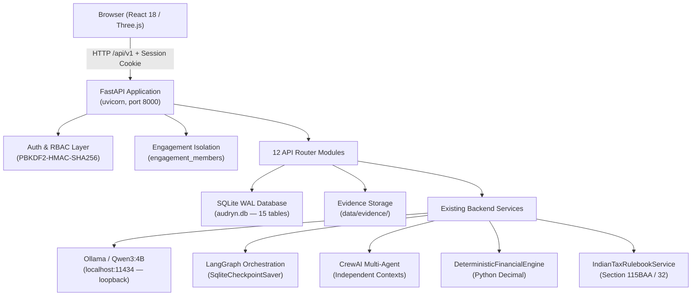
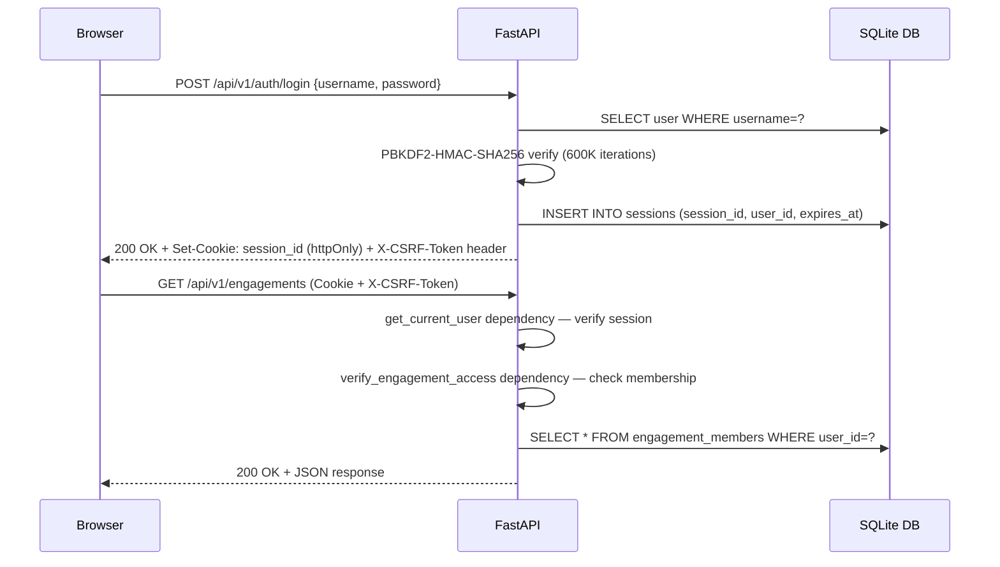
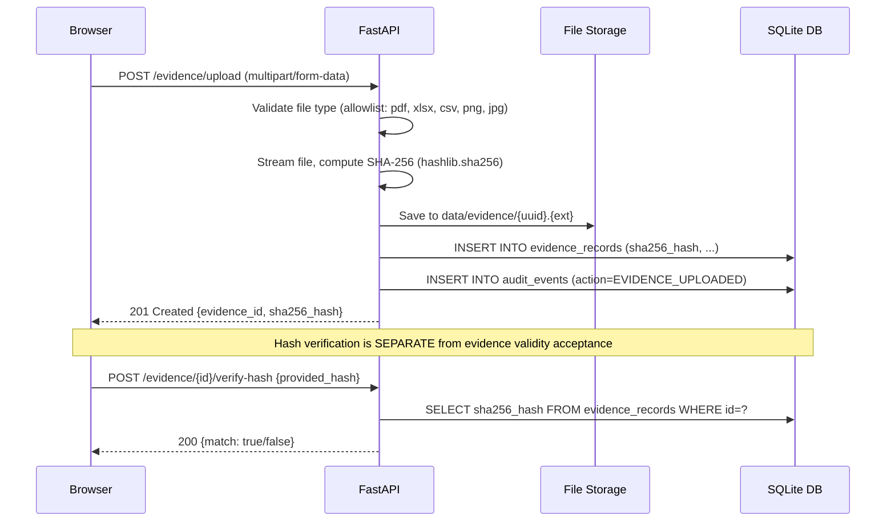
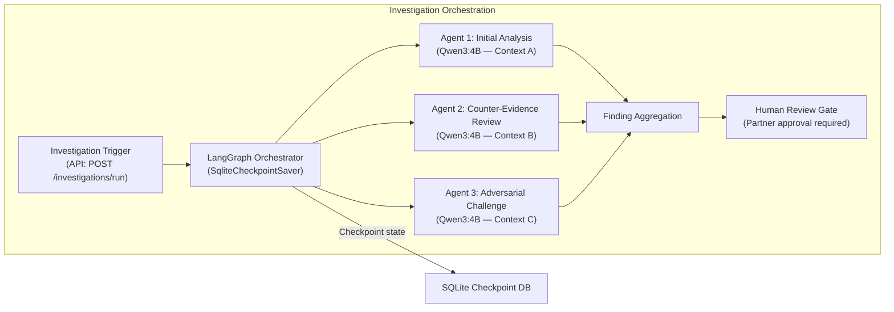

# AUDRYN — Project Architecture

> **Category:** Evidence-First Multi-Agent Financial Audit Intelligence System  
> **Version:** V2.1 (Phase 7 + Phase 8 Complete)  
> **Stack:** Python 3.13 · FastAPI · SQLite WAL · React 18 · Three.js · TypeScript

---

## System Overview



---

## Directory Structure

```
audryn/
├── backend/
│   ├── app/
│   │   ├── main.py                 # FastAPI app: lifespan, middleware, routers
│   │   ├── auth.py                 # PBKDF2 auth, sessions, CSRF, rate limiting
│   │   ├── rbac.py                 # Role enum, Permission enum, ROLE_PERMISSIONS
│   │   ├── isolation.py            # EngagementIsolationService
│   │   ├── bootstrap_admin.py      # Safe admin bootstrap (no hardcoded creds)
│   │   └── api/
│   │       ├── health.py           # GET /health
│   │       ├── auth.py             # POST /auth/login|logout, GET /auth/me
│   │       ├── engagements.py      # CRUD /engagements
│   │       ├── evidence.py         # Upload, verify-hash, validity decisions
│   │       ├── completeness.py     # Completeness gate, not-checked register
│   │       ├── investigations.py   # Jobs, findings
│   │       ├── counter_evidence.py # ReviewVerdict challenges
│   │       ├── human_review.py     # Decisions with identity+reason+timestamp
│   │       ├── calculations.py     # Decimal engine, Section 115BAA, Section 32
│   │       ├── provenance.py       # Evidence relationship graph
│   │       ├── reports.py          # Draft + finalize reports
│   │       └── audit_events.py     # Immutable event trail
│   ├── db/
│   │   ├── connection.py           # DatabaseManager (WAL mode)
│   │   ├── migrate.py              # Idempotent migration runner
│   │   ├── migrations/
│   │   │   └── 001_initial_schema.sql  # 15-table schema
│   │   └── repositories.py         # 9 repository classes
│   └── services/                   # Pre-existing domain services (Phase 1–6)
├── frontend/
│   ├── src/
│   │   ├── pages/app/AppShell.tsx  # Main application shell (11 workspaces)
│   │   ├── services/api.ts          # AudrynApiClient — typed HTTP client
│   │   ├── types/index.ts           # TypeScript domain types
│   │   └── components/              # UI components, 3D scene, cursor
│   └── dist/                        # Production build output
├── tests/
│   ├── unit/                        # Unit tests (171 baseline + Phase 7 + Phase 8)
│   └── integration/                 # Integration tests (Phase 8 E2E)
├── data/
│   ├── db/audryn.db                 # SQLite production database (WAL)
│   └── evidence/                    # Uploaded evidence files
└── docs/
    ├── openapi.json                  # Generated OpenAPI contract (60 KB)
    └── ...                           # Documentation files
```

---

## Data Flow

### Authentication Flow



### Evidence Ingestion Flow



---

## Multi-Agent Architecture

> **[IMPORTANT]** The LangGraph and CrewAI agents run in **independent contexts** (separate conversation histories / review roles). They use the **same base model (Qwen3:4B via Ollama)**. This is not model-independent validation — it is independent-context challenge.



---

## Security Architecture

| Layer | Control |
|-------|---------|
| Password Hashing | PBKDF2-HMAC-SHA256, 600,000 iterations (stdlib hashlib) |
| Session Management | Server-side, httpOnly cookie, 30min idle / 12hr absolute timeout |
| CSRF | Per-session token in `X-CSRF-Token` header, verified on all state-changing requests |
| Rate Limiting | 5 failed attempts → 15-minute lockout (in-memory per process) |
| RBAC | 4 roles × 25 permissions, enforced at every route via FastAPI dependency |
| Engagement Isolation | `engagement_members` table, `verify_engagement_access` dependency |
| File Upload | Extension allowlist + MIME type check |
| Security Headers | `X-Content-Type-Options: nosniff`, `X-Frame-Options: DENY`, `Referrer-Policy: strict-origin-when-cross-origin` |
| CORS | Restricted to `localhost:5173`, `localhost:4173` |
| Ollama Calls | Loopback only (`127.0.0.1:11434`) |

> **[WARNING]** Rate limiting uses in-memory state and resets on process restart. Production deployment requires a persistent rate-limit store (Redis or DB-backed).

---

## Role-Permission Matrix

| Permission | Associate | Senior | Manager | Partner |
|-----------|-----------|--------|---------|---------|
| VIEW_ENGAGEMENT | ✓ | ✓ | ✓ | ✓ |
| UPLOAD_EVIDENCE | ✓ | ✓ | ✓ | ✓ |
| VERIFY_HASH | ✓ | ✓ | ✓ | ✓ |
| RUN_INVESTIGATION | — | ✓ | ✓ | ✓ |
| VIEW_FINDINGS | ✓ | ✓ | ✓ | ✓ |
| SUBMIT_COUNTER_EVIDENCE | — | ✓ | ✓ | ✓ |
| HUMAN_REVIEW_DECIDE | — | — | ✓ | ✓ |
| APPROVE_FINDING | — | — | — | ✓ |
| GENERATE_REPORT | — | — | ✓ | ✓ |
| FINALIZE_REPORT | — | — | — | ✓ |
| MANAGE_ENGAGEMENTS | — | — | ✓ | ✓ |
| ADD_MEMBERS | — | — | ✓ | ✓ |
| VIEW_AUDIT_EVENTS | — | — | ✓ | ✓ |

> Full 25-permission matrix is in `backend/app/rbac.py`.

---

## Network Egress Profile

> **[CAUTION]** Network-level packet-capture verification was not performed. The following reflects code-level inspection only.

| Destination | Purpose | Verified |
|-------------|---------|---------|
| `127.0.0.1:11434` | Ollama LLM inference | Code-level |
| `localhost:5173` / `localhost:4173` | Frontend dev server (CORS whitelist) | Code-level |
| None (self-hosted fonts) | IBM Plex Sans/Mono, Newsreader | Code-level |
| External network | None intentional | **Unverified — requires OS-level monitoring** |

---

## Deployment Topology (Local Development)

```
Terminal 1: uvicorn backend.app.main:app --port 8000
Terminal 2: cd frontend && npm run dev  (proxies /api/v1 → localhost:8000)
Browser:    http://localhost:5173
```

See [LOCAL_SETUP_GUIDE.md](LOCAL_SETUP_GUIDE.md) for full setup instructions.
