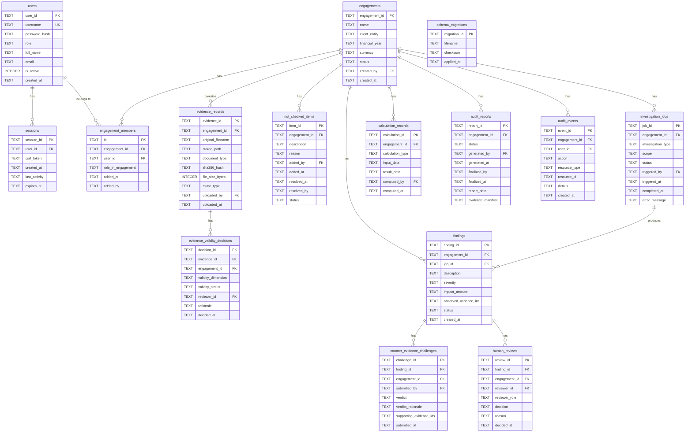

# AUDRYN — Database Schema

> **Engine:** SQLite 3 (WAL mode)  
> **Tables:** 15  
> **Migrations:** `backend/db/migrations/`  
> **Runner:** `backend/db/migrate.py` (idempotent, SHA-256 checksum verification)

---

## Entity Relationship Overview



---

## Table Descriptions

### `users`
Stores auditor accounts. Passwords are stored as PBKDF2-HMAC-SHA256 hashes (never plaintext).  
`role` values: `Associate`, `Senior`, `Manager`, `Partner`.

### `sessions`
Server-side session records. Each login creates a new row.  
Sessions expire by idle timeout (30 min) and absolute timeout (12 hr).  
Logout deletes the row.

### `engagements`
One row per audit engagement. The `engagement_id` (e.g., `ENG-APEX-FY24`) is the primary routing key for all engagement-scoped APIs.

### `engagement_members`
Junction table linking users to engagements with their role in that engagement.  
Drives the `verify_engagement_access` IDOR prevention dependency.

### `evidence_records`
One row per uploaded document. `sha256_hash` is the content fingerprint computed at upload time.  
**Hash match ≠ evidence acceptance** — see `evidence_validity_decisions`.

### `evidence_validity_decisions`
Tracks reviewer decisions across three independent dimensions:
- `CALCULATION_CORRECTNESS`
- `SOURCE_INTEGRITY`
- `EVIDENCE_VALIDITY`

Valid `validity_status` values: `ACCEPTED_FOR_STATED_PURPOSE`, `REJECTED`, `PENDING_REVIEW`, `INSUFFICIENT`.

> **[IMPORTANT]** These three dimensions must remain independent. Never combine them into a single VERIFIED badge.

### `not_checked_items`
Audit items explicitly marked as outside scope or not inspected, with mandatory reasons.

### `investigation_jobs`
Job records for LLM-orchestrated investigation runs.

### `findings`
Anomalies, discrepancies, or issues identified by investigation agents or manually.

### `counter_evidence_challenges`
Challenges submitted against findings. `verdict` must be one of the canonical `ReviewVerdict` values:  
`SUPPORTED`, `CONTRADICTED`, `PARTIALLY_SUPPORTED`, `UNRESOLVED`, `INSUFFICIENT_EVIDENCE`.

### `human_reviews`
Immutable records of human review decisions with reviewer identity, role, reason, and timestamp.  
`APPROVE` decisions by `Partner` role display in Brass (`#C5A059`).

### `calculation_records`
Stores inputs and results of deterministic financial calculations (Python `Decimal` engine).

### `audit_reports`
Draft and finalized audit report records. `evidence_manifest` contains SHA-256 hashes of all evidence referenced in the report.

### `audit_events`
Append-only audit trail. Every significant system action inserts a row.  
Not delete-protected at the DB level — append-only discipline is application-enforced.

### `schema_migrations`
Migration history. Each migration's SQL file content is SHA-256 hashed and stored to detect tampering.

---

## Indexes

Key indexes defined in `001_initial_schema.sql`:

| Table | Index Column(s) |
|-------|----------------|
| `sessions` | `user_id`, `expires_at` |
| `engagement_members` | `(engagement_id, user_id)` UNIQUE |
| `evidence_records` | `engagement_id`, `sha256_hash` |
| `findings` | `engagement_id`, `job_id` |
| `audit_events` | `engagement_id`, `user_id`, `created_at` |

---

## SQLite Configuration

```sql
PRAGMA journal_mode = WAL;        -- Write-Ahead Logging for concurrent reads
PRAGMA foreign_keys = ON;         -- Enforce referential integrity
PRAGMA synchronous = NORMAL;      -- Balance durability vs. performance
PRAGMA busy_timeout = 5000;       -- 5s timeout on locked DB
```
