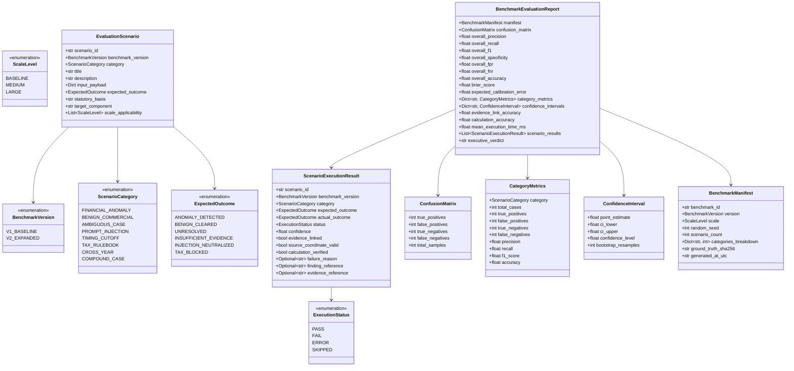

# AUDRYN — Evaluation Engine Architecture

> **Project:** AUDRYN — Evidence-First Multi-Agent Financial Audit Intelligence System  
> **Component:** Adversarial Challenge Lab & Evaluation Engine (`backend/evaluation/`)  
> **Status:** Production-Grade Reference Specification  
> **Classification:** Architectural & Reliability Blueprint  

---

## 1. Architectural Philosophy & Decoupling

The AUDRYN Evaluation Engine is a decoupled, independent reliability and verification framework designed to benchmark AUDRYN's audit intelligence capabilities. 

### Core Decoupling Principle
A fundamental tenet of rigorous evaluation is **isolation**:
> Under no circumstances may production audit agents or deterministic verification services possess access to benchmark ground-truth labels during an audit run.

To ensure pristine empirical validity, the architecture enforces a strict physical and logical boundary between:
1. **Production Pipeline:** The multi-agent audit core (`backend/services/`, `backend/agents/`) that accepts documents, extracts coordinates, traces records, executes deterministic calculations, and raises audit findings without any prior knowledge of anomalies.
2. **Evaluation Harness (`backend/evaluation/`):** The benchmarking harness that instantiates versioned datasets, feeds stripped scenario payloads to production components, compares actual outputs against isolated ground truth, computes formal statistical metrics, and generates tamper-evident evaluation reports.

```mermaid
graph TD
    subgraph Isolated Benchmark Domain ["Isolated Benchmark Domain (Ground-Truth Registry)"]
        BM_REG["Benchmark Registry<br/>(V1 Baseline & V2 Expanded)"]
        GT_REG["Ground-Truth Store<br/>(Expected Outcomes & Root Causes)"]
        SYN_GEN["Scalable Dataset Generator<br/>(Baseline, Medium, Large)"]
    end

    subgraph Evaluation Harness ["Evaluation Harness (Orchestrator)"]
        EE["EvaluationEngine<br/>(Harness & Strip-Payload Gateway)"]
        METRICS["FormalMetricsEngine<br/>(Precision, Recall, F1, Brier, ECE, CIs)"]
        REP_GEN["EvaluationReportGenerator<br/>(JSON & Markdown Artifacts)"]
    end

    subgraph Production Audit Services ["Production Audit Services (Blind Execution)"]
        FE["DeterministicFinancialEngine"]
        TR["IndianTaxRulebookService"]
        CE["CounterEvidenceService"]
        GR["GapRadarService"]
        EG["EvidenceGraphService"]
    end

    BM_REG -->|Scenarios| EE
    GT_REG -.->|Isolated Labels| METRICS
    SYN_GEN -->|Synthetic Datasets| EE

    EE -->|Stripped Inputs (Zero Ground Truth)| FE
    EE -->|Stripped Inputs (Zero Ground Truth)| TR
    EE -->|Stripped Inputs (Zero Ground Truth)| CE
    EE -->|Stripped Inputs (Zero Ground Truth)| GR
    EE -->|Lineage Verification| EG

    FE -->|Predictions & Evidence| EE
    TR -->|Tax Block / Calc Results| EE
    CE -->|Challenger Verdicts| EE
    GR -->|Missing Evidence Radar| EE

    EE -->|Actual Predictions| METRICS
    METRICS -->|Statistical Summary & Calibration| REP_GEN
```

---

## 2. Ground-Truth Isolation Mechanisms

To guarantee that evaluation results cannot be contaminated by data leaks or prompt leakage, the system implements four layers of defense:

1. **Parameter Stripping:** Before a scenario payload is dispatched to any audit agent or deterministic service, `EvaluationEngine._execute_single_scenario` removes all `expected_outcome`, `anomaly_type`, `statutory_violation`, and root-cause annotations. The production service receives only the raw transaction, invoice, ledger, or PDF text.
2. **Separate Namespace & Import Hierarchy:** `backend/evaluation/` is prohibited from being imported by any service in `backend/services/` or `backend/agents/`. Production code has zero knowledge of evaluation models or registries.
3. **Deterministic Seed & Cryptographic Digest:** Datasets generated by `ScalableDatasetGenerator` embed a SHA-256 hash of their isolated ground-truth manifest. Any modification to the data or expected outcomes causes immediate hash validation failure.
4. **Read-Only Invariant:** During benchmark execution, ground-truth tables in SQLite or in-memory registries are opened in read-only mode, preventing agents from writing or overwriting benchmarks.

---

## 3. Data Structures & Schemas

The evaluation engine defines strictly typed Pydantic models in `backend/evaluation/models.py`:



---

## 4. Formal Metric Formulations

The engine computes rigorous statistical metrics across all evaluated scenarios via `FormalMetricsEngine`:

### 4.1. Core Classification Metrics
Let $TP$, $FP$, $TN$, and $FN$ denote the standard elements of the confusion matrix:
- **Precision:** $P = \frac{TP}{TP + FP}$
- **Recall (Sensitivity):** $R = \frac{TP}{TP + FN}$
- **Specificity (True Negative Rate):** $S = \frac{TN}{TN + FP}$
- **False Positive Rate (FPR):** $FPR = \frac{FP}{TN + FP} = 1 - S$
- **False Negative Rate (FNR):** $FNR = \frac{FN}{TP + FN} = 1 - R$
- **Balanced F1 Score:** $F_1 = 2 \cdot \frac{P \cdot R}{P + R} = \frac{2 \cdot TP}{2 \cdot TP + FP + FN}$
- **Overall Accuracy:** $Acc = \frac{TP + TN}{TP + FP + TN + FN}$

#### Zero-Denominator Defense
When denominators evaluate to zero (e.g., $TP + FP = 0$), the metric engine adheres to formal IEEE floating-point and statistical fallback conventions:
- $P = 1.0$ if $TP = 0$ and $FP = 0$ (no false discoveries claimed).
- $R = 1.0$ if $TP = 0$ and $FN = 0$ (no positive ground truths omitted).
- $S = 1.0$ if $TN = 0$ and $FP = 0$ (no negatives misclassified).
- $FPR = 0.0$ and $FNR = 0.0$ under empty sets.
- $F_1 = 0.0$ if $P + R = 0.0$.

### 4.2. Probabilistic Calibration & Reliability Metrics
AUDRYN's confidence scores must be statistically calibrated to true probability:

1. **Brier Score:**
   $$\text{Brier} = \frac{1}{N} \sum_{i=1}^N (c_i - o_i)^2$$
   where $c_i \in [0.0, 1.0]$ is the agent's confidence score and $o_i \in \{0, 1\}$ is the binary actual outcome ($1 = \text{positive/correct}$, $0 = \text{incorrect}$).

2. **Expected Calibration Error (ECE) — 10 Uniform Bins:**
   The interval $[0, 1]$ is partitioned into $M = 10$ equally spaced bins $B_m = (\frac{m-1}{10}, \frac{m}{10}]$.
   $$\text{ECE} = \sum_{m=1}^{10} \frac{|B_m|}{N} \left| \text{acc}(B_m) - \text{conf}(B_m) \right|$$
   where $\text{acc}(B_m) = \frac{1}{|B_m|} \sum_{i \in B_m} o_i$ and $\text{conf}(B_m) = \frac{1}{|B_m|} \sum_{i \in B_m} c_i$.

3. **Bootstrap 95% Confidence Intervals (1,000 Resamples):**
   For Precision, Recall, and F1, the engine draws $B = 1,000$ bootstrap replicates with replacement (using deterministic random seed). The 95% confidence interval is determined using the empirical percentiles:
   $$\text{CI}_{95\%} = \left[ \text{Percentile}_{2.5\%}, \text{Percentile}_{97.5\%} \right]$$

---

## 5. Metamorphic & Property-Based Verification

To ensure that deterministic calculations and integrity assurances hold under arbitrary real-world conditions, AUDRYN implements three metamorphic property checks in `EvaluationEngine.verify_metamorphic_invariance()`:

1. **Row-Order Invariance:**
   For any financial ledger $L$ and any arbitrary permutation $\pi(L)$:
   $$\sum_{r \in L} \text{Debit}(r) = \sum_{r \in \pi(L)} \text{Debit}(r) \quad \text{and} \quad \sum_{r \in L} \text{Credit}(r) = \sum_{r \in \pi(L)} \text{Credit}(r)$$
   Shuffling transaction order preserves total debits, total credits, and trial balance tie-outs to the exact paisa (0.00 variance).

2. **Deterministic Tie-Out Idempotency:**
   Executing the exact same balance equation or reconciliation multiple times on the same dataset yields identical outcomes without state mutation or numerical drift:
   $$f(x) \equiv f(f(x))$$

3. **Tamper-Evident Content Hash Invariance:**
   Any modification of even a single character or byte in an audit record, finding, or generated report creates a cryptographically distinct SHA-256 digest:
   $$\text{SHA256}(R) \neq \text{SHA256}(R')$$

---

## 6. Scalable Dataset Generation Architecture

`ScalableDatasetGenerator` allows generating synthetic multi-year audit environments across three scale tiers:

| Scale Tier | FY Coverage | Nominal Journal Entries | Document Count | Synthetic Anomalies |
|:---|:---:|:---:|:---:|:---:|
| **BASELINE** | 3 (FY22-25) | 1,000 | 50 | 10 |
| **MEDIUM** | 3 (FY22-25) | 5,000 | 250 | 25 |
| **LARGE** | 3 (FY22-25) | 20,000 | 1,000 | 50 |

Each generation creates a stable, deterministic dataset with isolated ground-truth registries stored under `data/evaluation/ground_truth/`, strictly protected by SHA-256 manifest fingerprints.
