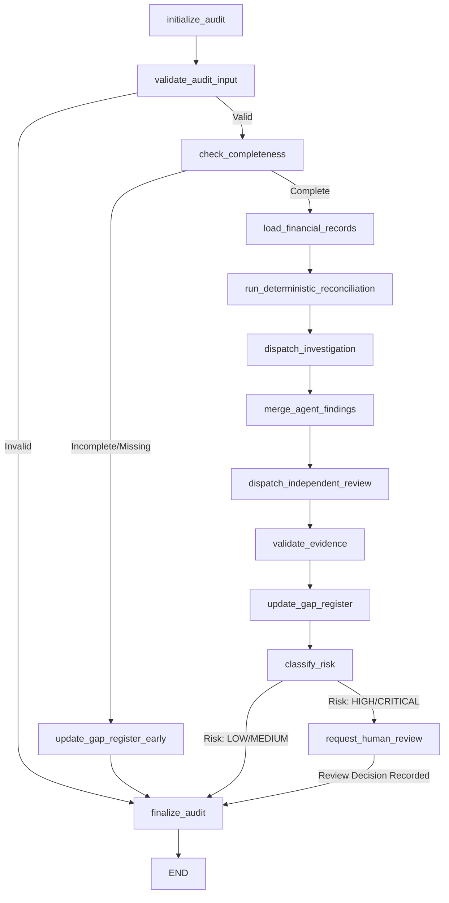

# AUDRYN — LangGraph Workflow Specification

> **Document ID:** AUDRYN-WORKFLOW-001  
> **Status:** APPROVED  
> **Phase:** 3 — Multi-Agent Audit Core  

---

## 1. StateGraph Architecture

The LangGraph supervisor coordinates 13 nodes across 4 execution phases:

---

## 2. Node Execution Responsibilities

| # | Node Name | Input Channels | Output Channels | Deterministic Guard |
|---|---|---|---|---|
| 1 | `initialize_audit` | Raw params | `audit_id`, metadata | Generates unique audit thread identifier |
| 2 | `validate_audit_input` | Input state | `current_stage`, `execution_errors` | Blocks if `company_id`, `company_name`, or `financial_periods` empty |
| 3 | `check_completeness` | `extracted_records` | `completeness_status` | Evaluates mandatory documents; blocks if missing or corrupted |
| 4 | `load_financial_records` | `extracted_records` | `current_stage` | Validates trial balances and ledger files exist in memory |
| 5 | `run_deterministic_reconciliation` | `trial_balances` | `reconciliation_results` | Pure Python Decimal verification of debits vs credits & YoY roll-forward |
| 6 | `dispatch_investigation` | `reconciliation_results` | `investigation_findings` | Converts mathematical discrepancies into formal investigation findings |
| 7 | `merge_agent_findings` | `investigation_findings` | `investigation_findings` | Deduplicates and formats finding records |
| 8 | `dispatch_independent_review` | `investigation_findings` | `counter_evidence` | Generates structured counter-evidence challenges |
| 9 | `validate_evidence` | `investigation_findings` | `execution_errors` | Enforces that every finding cites document and coordinate provenance |
| 10 | `update_gap_register` | Findings, docs, errors | `gap_register` | Scans coverage blind spots, untested procedures, and missing links |
| 11 | `classify_risk` | Findings, gaps, reviews | `risk_classification`, `human_review_status` | Computes risk level; flags PENDING review if HIGH or CRITICAL |
| 12 | `request_human_review` | High risk state | Human interrupt | Pauses StateGraph before node execution using LangGraph checkpointing |
| 13 | `finalize_audit` | State summary | `final_report_status` | Blocks if completeness BLOCKED, review PENDING, or critical gaps remain |

---

## 3. Checkpointing & Recovery Protocols

1. **State Snapshotting:** Every state mutation is committed via LangGraph checkpointer (`MemorySaver` / SQLite).
2. **Interrupt & Resume:** When `classify_risk` detects critical anomalies, the graph halts. The human auditor inspects findings via `HumanReviewService`, logs their decision (`APPROVED`, `REJECTED`, `ESCALATED`), and resumes execution with `graph.invoke(None, config)`.
3. **Audit Isolation:** Audit threads are strictly isolated by `thread_id` (mapping directly to `audit_id`). State from Audit A can never leak into Audit B.
